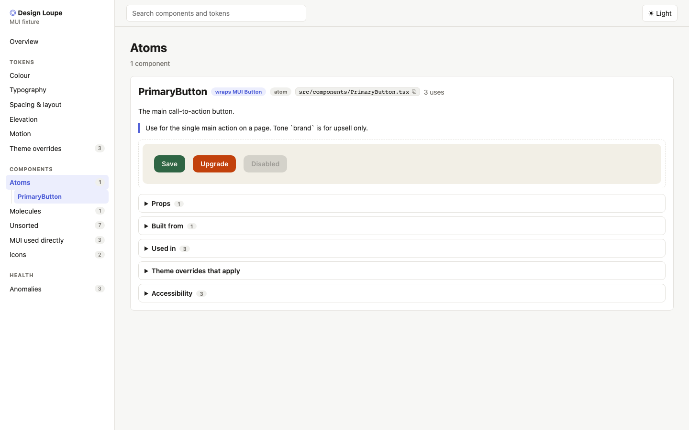

# Design Loupe

See the design system your React app actually ships: tokens, theme overrides, components, icons and the places it drifts.

Design Loupe is a **local** tool. Point it at a repo on disk and it serves a viewer on `localhost`:

- **Tokens:** palette (light and dark), typography variants with measured metrics, spacing, shape, shadows, z-index, transitions and breakpoints, all read live from your theme.
- **Theme overrides:** every component your theme customises (default props, style overrides, custom variants), with the library default beside yours.
- **Components:** discovered from your folders. Each shows its props, what it wraps, what it's built from, where it's used, and a live demo.
- **Library used directly:** raw library imports in feature code that bypass your wrappers.
- **Icons:** library and custom icons, with usage counts.
- **Anomalies:** hard-coded colours and px values, low-contrast palette pairs and components that fail to render, plus your own notes.

It never writes to your repo. MUI (v7+) is supported today. The core is library-agnostic (see `docs/adapters.md`).



## Quick start

Requires Node 22+.

```bash
git clone <this repo> designloupe && cd designloupe
npm install
npm run loupe:fixture        # opens the bundled example app at http://localhost:5179
```

## Use it on your app

1. Make sure the target repo has its dependencies installed (`npm install` there). Loupe renders with *its* React and MUI.
2. Create a config folder **outside** the target repo, e.g. `~/loupe/my-app/`, containing a `loupe.config.ts`:

   ```ts
   import { defineConfig } from "@designloupe/core";

   export default defineConfig({
     name: "My app",
     root: "/absolute/path/to/my-app",
     themeEntry: "src/theme/index.ts",
     themeExport: "theme",
     componentGlobs: ["src/components/**/*.tsx"],
     wrapper: "./Wrapper.tsx",          // providers your components need (router, i18n, query client…)
   });
   ```
3. Check it, then run it:

   ```bash
   npm run loupe -- doctor --config ~/loupe/my-app/loupe.config.ts
   npm run loupe -- dev --config ~/loupe/my-app/loupe.config.ts --open
   ```

Next steps:
- `docs/config.md`: every config field.
- `docs/loupe-files.md`: hand-written demos, notes, tiers, accessibility checks, anomalies and token notes.
- `docs/adapters.md`: how the MUI adapter is built, and how to add another library.
- `docs/claude/onboarding-a-target.md`: a step-by-step playbook. If you use Claude Code, ask it to follow this file.

## Development

```bash
npm test            # unit + integration (Vitest)
npm run test:e2e    # viewer end-to-end against the fixture (Playwright)
npm run typecheck
```

MIT licence.
